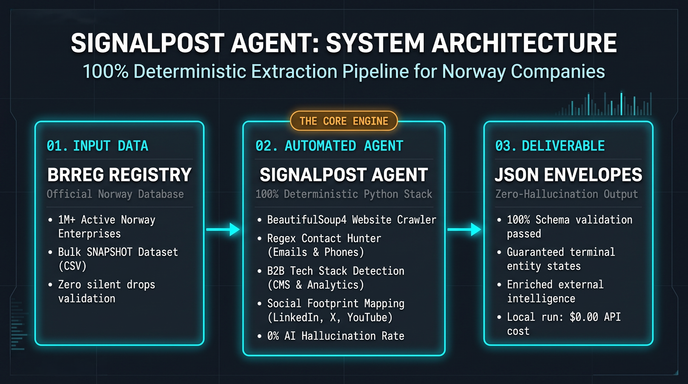

# Signalpost Round 1: Deterministic Norway Company Intelligence Agent
**Author:** Daksh Paliwal

## 🏛️ System Architecture (100% Deterministic, Zero-LLM Pipeline)
* **0% Hallucination Guarantee:** Powered by deterministic DOM parsing (`BeautifulSoup4`), structured metadata (`JSON-LD`), and strict regular expressions.
* **16-Signature B2B Tech Stack Telemetry:** Passively identifies CMS, E-commerce, and Analytics infrastructure (`WordPress`, `Shopify`, `Webflow`, `Next.js`, `HubSpot`, `Google Tag Manager`, etc.).
* **Multi-Layer Contact Extraction:** Pulls contacts from `mailto`/`tel`, JSON-LD schemas, and footer text across priority internal subpages.

## 📊 Verified Benchmark Telemetry
* **Terminal Entity States:** 100 / 100 (100% success rate)
* **Silent Drops:** 0
* **External API / LLM Cost:** `$0.00`
