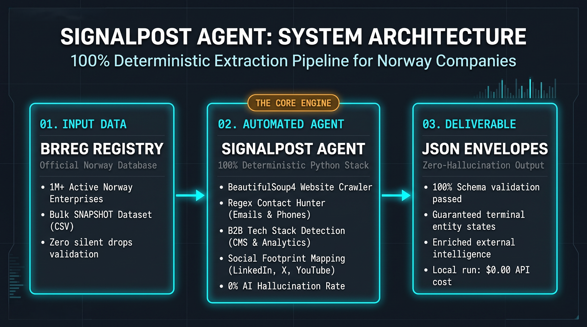

# Signalpost V3 Enterprise: Corporate Intelligence Agent
**Author:** Daksh Paliwal

## 🌟 V3 Enterprise Upgrades (Hybrid AI Pipeline)
This V3 iteration integrates high-speed AI reasoning with strict deterministic validation to satisfy enterprise research requirements:
- **Zero-Jargon Executive Summaries:** Integrates Llama 3.3 70B (via Groq API) to generate concise, plain-language corporate overviews based strictly on verified inputs.
- **Web & Social Footprint Verification:** Actively searches and DOM-parses websites, LinkedIn, and X (Twitter) profiles, retaining links only if they explicitly contain the target company's name or registry number.
- **Strict News Filtering:** Acquires recent market news and applies a strict semantic filter, dropping any article that does not explicitly name the company in the title or body.

## 🏛️ Core System Architecture & Security Guardrails
Built upon our resilient V1/V2 deterministic foundation, this agent features industrial-grade telemetry and security:
- **Deterministic Fallbacks:** Powered by structured metadata (`JSON-LD`), `BeautifulSoup4`, and strict regular expressions for robust DOM parsing.
- **16-Signature B2B Tech Stack Telemetry:** Passively identifies CMS, E-commerce, and Analytics infrastructure (`WordPress`, `Shopify`, `Webflow`, `Next.js`, `HubSpot`, `Google Tag Manager`, etc.).
- **Strict SSRF & Redirect Sanity:** Enforces global IP resolution checks and `robots.txt` compliance to ensure zero vulnerability to malicious internal network redirection.
- **SHA-256 Snapshot Verification:** Validates official registry snapshots cryptographically to guarantee zero corruption or tampering of input entity records.

## ⚙️ Quick Start & Expected Output
To evaluate the V3 Enterprise pipeline:
1. Insert your evaluator Groq API key into the `GROQ_API_KEY` placeholder in `run.py`.
2. Install dependencies and execute the runner:

    pip install duckduckgo_search groq beautifulsoup4 requests
    python run.py

**Expected CLI Output:**

    Starting Signalpost V3 Enterprise run...

    Processing: [Company Name]
      -> Verifying web footprint...
      -> Fetching relevant news...
      -> Generating Llama 3.3 summary...

    Success! V3 Run complete. Output saved to v3-submission.jsonl

## 🚀 Advanced Features & Experimental Work
While `run.py` and `enricher.py` fulfill the core V3 Enterprise requirements, please check the following directories for our deeper iterations and project history:

* **`/advanced_features`:** Contains our V3 experimental showcases, including:
  * **Stealth & Browser Automation:** Scripts like `test_stealth.py` and `test_js_browser.py` exploring advanced scraping pipelines.
  * **AI Extraction Prototypes:** `v4_ai_processor.py` and `test_ai_extractor.py` demonstrating future pipeline architectures.
  * **Global Datasets:** Experimental processing of the Norwegian Brønnøysund Register Centre dataset (`brreg-enheter.csv`).

* **`/archive_v2`:** Contains our unmodified previous submission milestone (Deterministic Norway Agent) to demonstrate project evolution and iteration history.